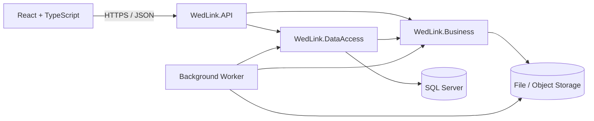

# WedLink — Proposed Architecture

**Status:** Task P0-T3 draft for review
**Basis:** BRD v1.0, `Documentation/Requirements/Decisions.md`, and the approved ERD
**Scope:** Application architecture, repository layout, and responsibility boundaries. This is a plan, not implementation.

## 1. Architecture overview

WedLink will use a React single-page frontend and an ASP.NET Core REST API. The backend keeps the three projects required by the BRD. SQL Server stores application records and media metadata; an interchangeable file-storage provider stores uploaded files and the final PNG card.



### Project dependency direction

- `WedLink.API` is the composition root. It references `WedLink.Business` and `WedLink.DataAccess` to register services.
- `WedLink.Business` contains business workflows and interfaces for data and file operations. It does not reference `WedLink.DataAccess` or the API project.
- `WedLink.DataAccess` references `WedLink.Business` to implement its interfaces. It owns EF Core, SQL Server mappings, and migrations.
- No project references the API project. This prevents circular dependencies.

## 2. Backend responsibilities

### `WedLink.API`

- Controllers and versioned routes under `/api/v1`.
- Request/response DTOs; database entities are not returned directly.
- Authentication and authorization setup, middleware, dependency injection, and API error responses.
- HTTP-level validation and mapping requests to Business services.

### `WedLink.Business`

- Order, invitation, payment, template, RSVP, media, and expiration rules.
- Services organized by feature, with small interfaces only where a boundary is useful (for example, repositories, storage, and time).
- Input rules that must hold regardless of which API endpoint is called.
- No ASP.NET controllers and no EF Core implementation details.

### `WedLink.DataAccess`

- EF Core `DbContext`, entity configurations, migrations, Identity persistence, and SQL queries.
- Implementations of Business-layer data interfaces.
- File-storage adapter metadata/configuration where appropriate; file bytes stay outside SQL Server.
- No business decisions such as whether an invitation may be republished.

## 3. Proposed repository layout

```text
WedLink/
├── Backend/
│   ├── WedLink.API/
│   │   ├── Controllers/
│   │   ├── Contracts/                 # HTTP request and response DTOs
│   │   ├── Middleware/
│   │   ├── Authentication/
│   │   └── Program.cs
│   ├── WedLink.Business/
│   │   ├── Customers/
│   │   ├── Orders/
│   │   ├── Templates/
│   │   ├── Invitations/
│   │   ├── Payments/
│   │   ├── Guests/                    # RSVP and messages
│   │   └── Abstractions/
│   ├── WedLink.DataAccess/
│   │   ├── Persistence/
│   │   │   ├── Configurations/
│   │   │   └── Migrations/
│   │   ├── Repositories/
│   │   └── Storage/
│   └── WedLink.sln
├── Frontend/
│   ├── public/
│   ├── src/
│   │   ├── app/                       # Router and app setup
│   │   ├── pages/
│   │   ├── features/                  # Orders, templates, invitations, etc.
│   │   ├── components/
│   │   ├── templates/                 # Trusted, versioned invitation UI
│   │   ├── services/                  # API client and shared API helpers
│   │   ├── schemas/                   # Form validation
│   │   └── styles/
│   └── package.json
├── Documentation/
│   ├── API/
│   ├── Architecture/
│   ├── ERD/
│   └── Requirements/
└── README.md
```

Folders should be added as the first related task needs them; do not create empty placeholder projects for every future feature at once.

## 4. Main request flows

### Admin creates and prepares an order

1. The admin signs in.
2. The API authenticates the admin and checks their permission on each protected request.
3. API controller validates the request shape and calls a Business service.
4. The Business service applies rules and uses data interfaces.
5. DataAccess persists changes and the Business service records important audit events.
6. The API returns a response DTO; the frontend updates the relevant screen.

### Customer submits wedding details

1. Admin creates a private, expiring submission token for one order.
2. Customer opens the private submission experience without creating an account.
3. The API validates the token and its order scope before returning or saving that order's data.
4. Uploaded file contents go to configured file storage; SQL stores metadata and storage keys.
5. Admin reviews the submission in the dashboard.

Private tokens are secrets. They must be random, stored as hashes, expiring and revocable. Avoid putting the raw token in API logs, analytics, or error responses. The exact browser-to-API token exchange will be chosen during implementation design.

### Guest opens an invitation

1. The browser requests an invitation by its public slug.
2. The API only serves published, unexpired, non-paused invitation data and only features supported by its saved template version.
3. Guest RSVP or message submissions pass server validation and rate limiting.
4. Guest media and private customer data are not included in the public response.

### Scheduled expiration and cleanup

The hosted background worker checks invitation expiration every five minutes by default and marks due Published/Paused invitations Expired through an idempotent database update. A separate worker checks media retention every 60 minutes by default, deletes due temporary objects, and marks database metadata deleted. Failed objects remain eligible for retry. The validity period defaults to two months after the wedding and can be changed for new publications through `InvitationLifecycle:DefaultValidityMonths`; existing invitations keep their stored expiry. Temporary media is permanently deleted after three months; the permanent PNG card, licensed music library, and historical order/payment records are excluded.

## 5. Frontend organization

- **Admin pages:** customers, orders, templates, invitations, payments, music, RSVP results, messages, users, audit log, and dashboard.
- **Private customer pages:** submission form and preview/review screen. No customer account or dashboard.
- **Public guest pages:** invitation route, RSVP and message forms, and event-ended page.
- **Template components:** trusted application code, registered by version. Admin metadata/configuration can switch supported options; it cannot upload and execute arbitrary code.
- **Shared UI:** form controls, loading/error states, RTL layout, and responsive components.

Keep API data fetching and form validation in small feature-level modules. Use one shared API client and avoid introducing a global state framework unless a concrete need appears.

## 6. Cross-cutting choices

- API prefix: `/api/v1`; JSON request and response bodies.
- Admin authentication: ASP.NET Core Identity with a secure, HTTP-only authentication cookie for the first-party dashboard. The selected topology serves the frontend and API on the same domain, with the API under `/api`; state-changing requests use ASP.NET Core antiforgery tokens. Do not store credentials or long-lived tokens in browser local storage.
- Authorization: backend policies/roles; frontend visibility is convenience only.
- Validation/errors: validate at API boundaries and repeat business-critical checks in Business services. Return consistent Problem Details responses without stack traces or secret values.
- Arabic/RTL: UI labels and layouts are Arabic-first; API field names remain stable and language-neutral.
- Time: preserve wedding local date/time and the `Africa/Cairo` time-zone meaning; use one injected time source for expiration calculations and scheduled jobs.
- Money: use decimal values and backend-calculated totals; preserve the agreed base price and add-on price snapshots.
- Media: validate content type, extension, size, and template-specific limits server-side. Stream large files instead of loading them all into memory.
- Logging: record operational failures and request correlation identifiers. Never log passwords, raw private tokens, file contents, or customer-uploaded secrets.
- API docs: generate OpenAPI documentation from the API project and add concise usage notes under `Documentation/API/`.

## 7. Background worker placement

For the MVP, run scheduled work in a hosted service within the backend deployment, using the Business and DataAccess services. Keep the worker entry point small and make each job safe to retry. If the web API later scales to multiple instances, add a distributed lock or move scheduled work into a dedicated worker process so the same job is not run concurrently.

## 8. Out of scope for this architecture

Online payment gateway, notifications, visitor analytics, customer accounts, guest accounts, unrestricted uploaded template code, and non-wedding invitation types remain outside the MVP.

## 9. Open implementation choices

These choices do not block this architecture plan and should be decided when their tasks begin:

- The frontend/API deployment must preserve the selected same-origin layout, with the API under `/api`.
- Concrete file/object storage provider and local development adapter.
- Whether the background worker remains hosted inside the API process or becomes a separate deployment.
- Exact token exchange and browser persistence for private customer links.

## Dashboard and audit log (P11)

The SuperAdmin dashboard queries order, invitation, and payment tables for Cairo date ranges. Audit write events are captured by an MVC action filter and stored in append-only `AuditLogs`; the searchable endpoint returns metadata only and is restricted to SuperAdmin.

## Public website and design showcase (P29)

The React app serves the marketing home and catalogue at `/` and demo design previews at `/designs/{templateId}`. `GET /api/v1/public/templates` queries only active templates with active versions and maps them to a separate public contract, excluding package keys and customer/order information. Admin routes stay under `/admin` with existing authentication and role authorization. WhatsApp contact configuration is provided by frontend environment variables.
