# WedLink — Proposed Entity Relationship Diagram

**Status:** Reviewed conceptual model; Customer and template catalog tables are implemented. Remaining business tables are planned.
**Basis:** BRD v1.0 and `Documentation/Requirements/Decisions.md`
**Scope:** Conceptual model for the WedLink business data.

## Design principles

- Keep order workflow status separate from invitation lifecycle status.
- Keep payment transactions as separate records and preserve agreed prices on the order.
- Bind each invitation to a specific template version so later template updates do not alter it.
- Store media metadata and storage references in SQL Server; store file contents in a file/object storage provider.
- Avoid customer and guest accounts. Admin identities are managed by ASP.NET Core Identity.
- Preserve important order, payment, and audit history. Use soft deletion for records that need to remain historically visible.

## Proposed ERD

```mermaid
erDiagram
    CUSTOMER ||--o{ ORDER : places
    ORDER ||--o{ ORDER_STATUS_HISTORY : tracks
    ORDER ||--o{ ORDER_ADDON : includes
    ADDON ||--o{ ORDER_ADDON : selected_as
    ORDER ||--o{ PAYMENT : has
    ORDER ||--o{ PRIVATE_LINK_TOKEN : grants_submission_or_preview
    ORDER ||--o| CUSTOMER_WEDDING_SUBMISSION : collects
    ORDER ||--o{ CUSTOMER_SUBMISSION_MEDIA : receives
    ORDER ||--o| INVITATION : produces
    TEMPLATE_VERSION ||--o{ ORDER : selected_for_order

    TEMPLATE ||--|{ TEMPLATE_VERSION : has_versions
    TEMPLATE_VERSION ||--o{ TEMPLATE_FEATURE : supports
    FEATURE ||--o{ TEMPLATE_FEATURE : describes
    TEMPLATE_VERSION ||--o{ TEMPLATE_ADDON : offers
    ADDON ||--o{ TEMPLATE_ADDON : available_on
    TEMPLATE_VERSION ||--o{ INVITATION : renders

    INVITATION ||--o{ INVITATION_CUSTOMIZATION : configures
    INVITATION ||--o{ INVITATION_MEDIA : contains
    INVITATION ||--o{ RSVP_RESPONSE : receives
    INVITATION ||--o{ GUEST_MESSAGE : receives
    INVITATION ||--o{ PREVIEW_REVIEW_EVENT : records
    MUSIC_TRACK o|--o{ INVITATION : selected_builtin_track

    ADMIN_USER ||--o{ AUDIT_LOG : performs

    CUSTOMER {
        int CustomerId PK
        string Name
        string Phone "Unique among active customers; spaces removed before save"
        string Email "Optional"
        string Notes "Optional"
        datetime CreatedAt
        datetime UpdatedAt "Optional"
        datetime DeletedAt "Optional"
    }

    ORDER {
        int OrderId PK
        int CustomerId FK
        int SelectedTemplateVersionId FK
        string Status
        decimal AgreedBasePrice
        string Currency
        datetime CreatedAt
        datetime UpdatedAt "Optional"
        datetime DeletedAt "Optional"
    }

    ORDER_STATUS_HISTORY {
        int OrderStatusHistoryId PK
        int OrderId FK
        string PreviousStatus "Optional"
        string NewStatus
        string ChangedByAdminUserId FK "ASP.NET Identity string key"
        datetime ChangedAt
        string Note "Optional"
    }

    PAYMENT {
        int PaymentId PK
        int OrderId FK
        decimal Amount
        string Method
        string Status
        datetime PaymentDate
        string Notes "Optional"
        int RecordedByAdminUserId FK
        datetime CreatedAt
    }

    TEMPLATE {
        int TemplateId PK
        string Name
        string Description "Optional"
        string PreviewImageReference "Optional"
        decimal CurrentPrice
        bool IsActive
        datetime CreatedAt
        datetime UpdatedAt "Optional"
    }

    TEMPLATE_VERSION {
        int TemplateVersionId PK
        int TemplateId FK
        string VersionNumber
        string PackageKey
        bool IsActive
        datetime CreatedAt
    }

    FEATURE {
        int FeatureId PK
        string Key
        string Name
        string Description "Optional"
    }

    TEMPLATE_FEATURE {
        int TemplateVersionId PK, FK
        int FeatureId PK, FK
        bool IsEnabled
        int MaximumCount "Optional"
        int MaximumFileSizeMb "Optional"
    }

    ADDON {
        int AddonId PK
        string Name
        string Description "Optional"
        decimal CurrentPrice
        string Currency
        bool IsActive
    }

    TEMPLATE_ADDON {
        int TemplateVersionId PK, FK
        int AddonId PK, FK
    }

    ORDER_ADDON {
        int OrderAddonId PK
        int OrderId FK
        int AddonId FK
        decimal PriceAtPurchase
        string NameAtPurchase
    }

    PRIVATE_LINK_TOKEN {
        int PrivateLinkTokenId PK
        int OrderId FK
        string TokenHash
        string Purpose
        datetime ExpiresAt
        datetime CreatedAt
        datetime RevokedAt "Optional"
        datetime UsedAt "Optional"
    }

    CUSTOMER_WEDDING_SUBMISSION {
        int CustomerWeddingSubmissionId PK
        int OrderId FK "Unique"
        string BrideName
        string GroomName
        datetime WeddingDateTimeLocal "Optional until submitted"
        string TimeZoneId
        string VenueName "Optional"
        string VenueAddress "Optional"
        string LocationUrl "Optional"
        json CustomizationsJson "Optional; supported template features only"
        datetime SubmittedAt "Optional"
        datetime AdminReviewedAt "Optional"
        string AdminReviewedByUserId FK "Optional"
    }

    CUSTOMER_SUBMISSION_MEDIA {
        int CustomerSubmissionMediaId PK
        int OrderId FK
        string OriginalFileName
        string ContentType
        long SizeBytes
        string StorageKey
        string MediaKind
        datetime UploadedAt
        datetime DeletedAt "Optional"
        string DeletedByAdminUserId FK "Optional"
    }

    INVITATION {
        int InvitationId PK
        int OrderId FK
        int TemplateVersionId FK
        int MusicTrackId FK "Optional"
        string Slug
        string Status
        datetime WeddingDateTimeLocal
        string TimeZoneId
        string CoupleNames "JSON array; supports Arabic names safely"
        string VenueName "Optional"
        string VenueAddress "Optional"
        string LocationUrl "Optional"
        datetime PublishedAt "Optional"
        datetime ExpiresAt "Optional until publication"
        datetime MediaDeleteAt "Optional until publication"
        datetime PausedAt "Optional"
        string FinalPngStorageKey "Optional"
        datetime CreatedAt
        datetime UpdatedAt "Optional"
    }

    INVITATION_CUSTOMIZATION {
        int InvitationCustomizationId PK
        int InvitationId FK
        string Key
        string ValueJson
    }

    INVITATION_MEDIA {
        int InvitationMediaId PK
        int InvitationId FK
        string MediaType
        string OriginalFileName
        string ContentType
        long SizeBytes
        string StorageKey
        int SortOrder
        datetime UploadedAt
        datetime DeletedAt "Optional"
    }

    MUSIC_TRACK {
        int MusicTrackId PK
        string Title
        string Artist "Optional"
        string RightsReference
        string StorageKey
        string ContentType
        bool IsActive
        datetime CreatedAt
    }

    RSVP_RESPONSE {
        int RsvpResponseId PK
        int InvitationId FK
        string Response
        string GuestName "Optional"
        int AccompanyingPeople
        string EditTokenHash "Required; hash only"
        datetime SubmittedAt
        datetime UpdatedAt "Optional"
    }

    PREVIEW_REVIEW_EVENT {
        int PreviewReviewEventId PK
        int InvitationId FK
        string Source
        string Action
        string Comment "Optional"
        string AdminUserId FK "Optional"
        datetime CreatedAt
    }

    GUEST_MESSAGE {
        int GuestMessageId PK
        int InvitationId FK
        string GuestName "Optional"
        string Message
        datetime SubmittedAt
        datetime DeletedAt "Optional"
        string DeletedByAdminUserId FK "Optional"
    }

    ADMIN_USER {
        string AdminUserId PK
        string IdentityUserFields
    }

    AUDIT_LOG {
        long AuditLogId PK
        string AdminUserId FK
        string Action
        string EntityType
        string EntityId
        string ChangeDetailsJson "Optional"
        datetime CreatedAt
    }
```

## Relationship notes

- A customer can have many orders. An order belongs to one customer.
- An order belongs to one customer and records the template version selected when the order is agreed. It can have multiple status-history entries, payments, private links, and add-on selections. Each add-on selection stores its agreed name and price snapshot.
- An order has one agreed base price, excluding add-ons. The order total is the base price plus the captured prices of its selected add-ons. Payments and remaining balance are calculated against that total.
- An order produces at most one invitation. A unique constraint on `INVITATION.OrderId` enforces the one-invitation-per-order rule.
- A template has versions. Each invitation references one exact version. A template version owns the feature configuration and the add-ons available for new orders.
- `TEMPLATE_FEATURE` stores feature support and configurable limits. A structured JSON value is proposed for varying limits to avoid adding a database column for each possible limit; the API must validate it against a defined schema.
- `ORDER_ADDON` is a historical snapshot. It must not rely on the add-on's current price or name when displaying an old order. The order's agreed base price excludes these add-on amounts.
- `PRIVATE_LINK_TOKEN` stores only a hash of a securely generated token. `Purpose` separates submission and preview links; token access is scoped to its order and has expiration/revocation.
- Invitation content and template settings are separate. `INVITATION_CUSTOMIZATION` stores only options supported by the referenced template version.
- `INVITATION_MEDIA` contains file metadata and a storage key, not file bytes. The final PNG is stored separately by its durable storage key and is not removed by temporary-media cleanup.
- `AccompanyingPeople` means additional people besides the responding guest. For a Yes response, expected attendance is `1 + AccompanyingPeople`; a No response contributes zero. A random edit token is stored in the guest's browser and only its hash is stored in the database. A repeat submission carrying that token updates the same RSVP response. The edit token is available only in the browser where the response was submitted.
- `PREVIEW_REVIEW_EVENT` preserves the history of preview sent, approval, and change-request events, including which preview version was reviewed. Keep events append-only.
- `WeddingDateTimeLocal` is the local civil date and time in the recorded `TimeZoneId`. Expiration and media cleanup are derived from that wedding date under the approved two-month and three-month rules.
- `ADMIN_USER` represents the ASP.NET Core Identity user. Identity's standard role/claim tables should be used for roles and permissions rather than introducing duplicate account tables.
- Audit logs are append-only for regular admins. The Super Admin can view them; ordinary update/delete paths must not exist.

## Indexes and constraints to include in detailed schema design

- Unique invitation `Slug`.
- Unique template version number within a template.
- Unique feature `Key` and add-on name/key as appropriate.
- Unique `(TemplateVersionId, FeatureId)` and `(TemplateVersionId, AddonId)` pairs.
- Indexes on order status and creation date, invitation status and expiration date, wedding date, RSVP invitation/date, and audit entity/time.
- Non-negative checks for agreed price, payment amount, add-on snapshot price, media size, and accompanying people.
- Foreign keys should prevent accidental deletion of customers, orders, template versions, payment history, or audit history that is still referenced.
- Store EGP amounts with a fixed decimal precision. Never use floating-point types for money.

## Items to confirm before detailed schema / implementation

1. **Payment status:** `Refunded` can describe an individual payment or a whole order. The detailed model should decide whether refunds are separate transactions rather than changing a payment row's status.

These are review questions for the model. No database migration or implementation should begin until the ERD and any required business decisions are approved.
